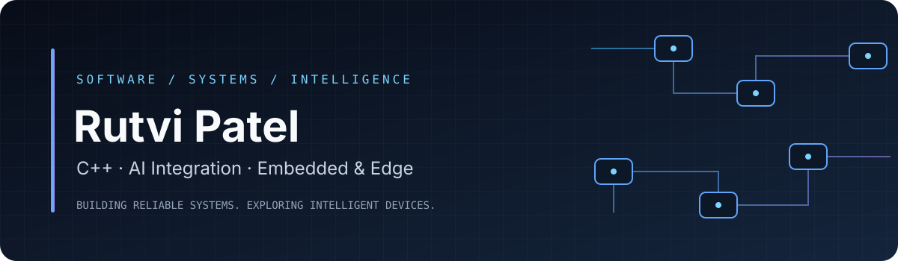

### Software & Systems Engineer
**C++ · AI Integration · Embedded & Edge Computing**

Exploring how reliable systems software and intelligent technologies come together.

---

## `about_me`

I'm a software engineer interested in building dependable software and understanding how systems work — from C++ applications and Linux environments to data, APIs, devices, and intelligent applications.

I'm expanding my skills toward **AI integration with C++**, with a particular interest in embedded systems, semiconductor software, and edge computing.

- **Working with:** C++, Python, Linux, SQL/SQLite, Git, CMake
- **Learning:** Machine learning fundamentals, model inference, and AI integration
- **Exploring:** Embedded AI, edge deployment, computer vision, and systems optimization
- **Interested in:** Systems software, platform engineering, embedded software, and AI-enabled devices

## `technology_map`

### Core engineering

  
  
  
  
  
  

### AI, embedded & edge — currently learning/exploring

  
  
  
  

## `selected_work`

> Projects will be added here as their code, documentation, and setup instructions are ready for public release.

| Project | Focus | Status |
|---|---|---|
| **PlayX** | Python · CLI · SQLite · Linux | Existing project — preparing for publication |
| **C++ System Monitor** | C++ · Linux · OS fundamentals | Planned |
| **Edge AI Inference** | C++ · ONNX Runtime · model inference | Planned |
| **Intelligent Device Monitor** | Sensor data · anomaly detection · edge AI | Planned |

## `github_activity`

 

---

*Build with curiosity. Engineer with intent.*

